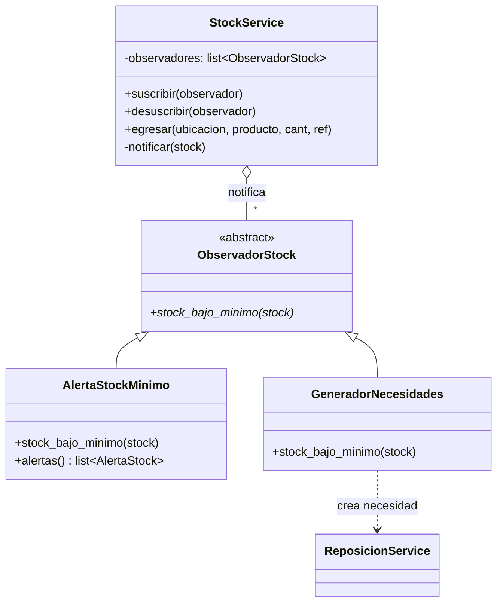
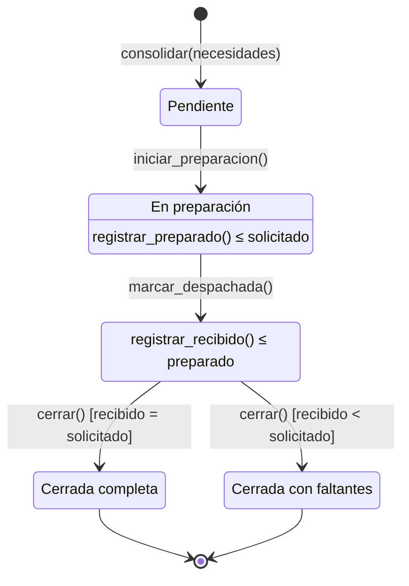
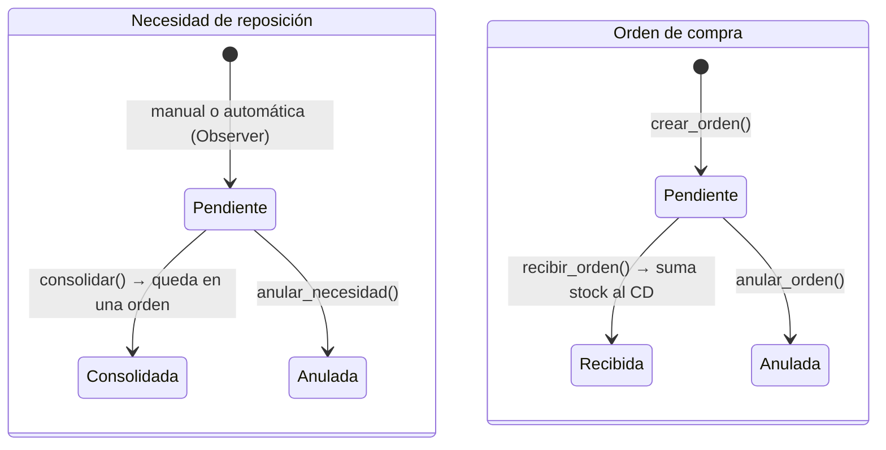

# Módulo de Inventario, Compras y Reposición – pohlsi

Implementa el paquete **Inventario y reposición** de `modelo_dominio.md`: el proceso **P3** (más el ingreso de
compras al CD), la base de las validaciones **V1** y **V3**, el patrón **Observer** y los reportes **R3** y **R4**.
Publica el `StockService`, por el que pasa **todo** cambio de stock del sistema (logística y ventas lo usan).

## Qué hay y dónde

| Capa | Archivo | Contenido |
|------|---------|-----------|
| Dominio | `src/dominio/inventario/modelos.py` | `Stock`, `MovimientoStock`, `TipoMovimiento`, `Referencia`, `OrdenCompra`, `NecesidadReposicion`, `OrdenReposicion` y sus detalles y estados |
| Esquema | `src/persistencia/esquema/02_inventario.sql` | Tablas, `UNIQUE`, `CHECK` y triggers que impiden modificar o borrar movimientos |
| Persistencia | `src/persistencia/repositorio_inventario.py` | Un repositorio por tabla (heredan de `RepositorioBase`) |
| Servicios | `src/servicios/stock_service.py` | `StockService` (contrato compartido) |
| | `src/servicios/observadores_stock.py` | `ObservadorStock` (interfaz) y `AlertaStockMinimo` |
| | `src/servicios/generador_necesidades.py` | `GeneradorNecesidades` (segundo observador) |
| | `src/servicios/compras_service.py` | Órdenes de compra al CD |
| | `src/servicios/reposicion_service.py` | Necesidades, consolidación y ciclo de vida de la orden de reposición (P3) |
| | `src/servicios/inventario_app.py` | Arma el `StockService` de la aplicación con sus observadores |
| Reportes | `src/reportes/inventario_reporte.py` | R3 y R4 |
| Pantallas | `src/ui/pantallas/inventario.py` | Menú **Inventario** y los reportes R3 y R4 del menú **Reportes** |
| Datos de prueba | `src/datos_prueba_inventario.py` | `python -m src.datos_prueba_inventario` o menú Inventario → Cargar stock de prueba |
| Tests (pytest) | `tests/test_stock_service.py`, `test_compras_service.py`, `test_reposicion_service.py`, `test_inventario_reportes.py`, `test_inventario_app.py` | `python -m pytest` |

## Trazabilidad con la consigna

| Requisito | Cómo se cumple |
|-----------|----------------|
| **P3** – consolidar necesidades en una orden de reposición con origen y destino | `ReposicionService.consolidar`: junta las necesidades pendientes de **un** local en **una** `OrdenReposicion` (origen = CD activo, destino = la sucursal), sumando cantidades por producto. Cada necesidad queda `CONSOLIDADA` y apunta a su orden. |
| Necesidades manuales o calculadas | `crear_necesidad` (manual) y `sugerir_necesidad`: **mínimo − disponible − pendiente** (lo que ya viene en camino no se vuelve a pedir). |
| Compras / ingreso del proveedor al CD | `ComprasService`: orden `PENDIENTE` → `recibir_orden` suma el stock del CD en una sola transacción → `RECIBIDA`. Solo se reciben o anulan órdenes pendientes. |
| *(Opcional)* Compras sugeridas por faltantes del CD | `ComprasService.sugerir_compras`: para cada producto del CD en su mínimo, **mínimo − disponible − lo ya pedido en órdenes pendientes**, agrupado por el proveedor activo con menor costo pactado. En la pantalla, el botón *Sugerir según faltantes del CD* lo carga en la nueva orden para revisarla antes de crearla. |
| **V1** – no vender lo que no se verificó | El stock tiene tres baldes: **pendiente**, **disponible** y **merma**. Lo que llega a un local entra como pendiente (`ingresar_pendiente`) y recién pasa a disponible con `confirmar_disponible`; un rechazo pasa a merma (`registrar_merma`). Solo el disponible se puede vender. |
| **V3** – no vender más que lo disponible | `egresar` lanza `StockInsuficienteError` si no alcanza el **disponible**. Además, la base tiene `CHECK (cantidad_disponible >= 0)`. |
| Trazabilidad del stock | Cada operación deja un `MovimientoStock` (tipo, cantidad, costo, documento de origen, usuario, fecha y hora). Los movimientos **no se pueden modificar ni borrar** (triggers en la base). |
| **Patrón Observer** | Ver abajo. |
| **R3** – movimientos y valorización | Ver *Reportes*. |
| **R4** – tiempo de tránsito CD → locales | Ver *Reportes*. |

## Patrón Observer

- **Subject:** `StockService`. Después de cada egreso (venta o despacho) consulta a maestros
  `StockMinimoService.esta_en_minimo(...)`; si el disponible llegó al mínimo, notifica a todos los suscriptos.
  No sabe qué hace cada uno con el aviso.
- **Observer:** `ObservadorStock` es una clase abstracta (`ABC` + `@abstractmethod`).
  - `AlertaStockMinimo` guarda una alerta por producto y ubicación y avisa a la interfaz: la ventana principal la
    muestra en la barra de abajo y la pantalla *Stock por ubicación* lista las alertas vigentes.
  - `GeneradorNecesidades` crea una `NecesidadReposicion` **automática** para la sucursal. No duplica si ya hay una
    abierta para ese producto, y no actúa sobre el CD (ahí hace falta una compra, no una reposición).
- Un observador que falla no frena la venta: el error se registra en el log y el egreso se completa.
- La ventana principal crea **un único** `StockService` con sus observadores (`crear_stock_service`) y lo comparte
  como `ventana.stock_service`; así lo toman la pantalla de ventas (vinchi) y el reporte R1 (brache).

## Diagramas de estados

### Orden de reposición (P3)

Las transiciones válidas están en la tabla `TRANSICIONES` de `reposicion_service.py`; cualquier otra lanza
`ValidacionError` (por ejemplo, no se puede despachar una orden pendiente ni cerrar una que no salió del CD).
El armado de bultos, el despacho y la recepción los hace logística (turco), que llama a `registrar_preparado`,
`marcar_despachada` y `registrar_recibido`.

### Necesidad de reposición y orden de compra

### Stock: los tres baldes

| Operación del `StockService` | Pendiente | Disponible | Merma | Tipo de movimiento |
|-------------------------------|:---------:|:----------:|:-----:|--------------------|
| `ingresar_compra` (solo CD) | | + | | `INGRESO_COMPRA` |
| `egresar(..., tipo=EGRESO_DESPACHO)` | | − | | `EGRESO_DESPACHO` |
| `ingresar_pendiente` | + | | | `INGRESO_PENDIENTE` |
| `confirmar_disponible` | − | + | | `CONFIRMACION_VERIFICADO` |
| `registrar_merma` | − | | + | `MERMA_RECHAZO` |
| `egresar` (venta) | | − | | `EGRESO_VENTA` |
| `reingresar` | | + | | `REINGRESO_DEVOLUCION` |

## Para los demás módulos

- **Referencia del documento (`ref`):** se acepta `Referencia("VENTA", 15)` o el texto `"VENTA:15"`; los dos se
  guardan como tipo `VENTA` y documento `15`. Si el llamador ya abrió una transacción, el `StockService` se suma a
  ella: si la venta falla después, el stock vuelve atrás.
- **Ventas (vinchi):** usar el `stock_service` de la ventana principal (ya lo hace la pantalla de ventas).
- **Logística (turco):** para que el **R4** funcione, todos los movimientos de un remito tienen que llevar
  `Referencia("REMITO", remito_id)`:
  - al despachar: `egresar(cd, producto, cant, ref, tipo=TipoMovimiento.EGRESO_DESPACHO)` y
    `ingresar_pendiente(sucursal, producto, cant, ref)`;
  - al cerrar la recepción: `confirmar_disponible` por los bultos verificados y `registrar_merma` por los rechazados.
  - El avance de la orden se informa con `iniciar_preparacion`, `registrar_preparado`, `marcar_despachada` y
    `registrar_recibido` de `ReposicionService`.

## Reportes

**R3 – Movimientos y valorización del inventario.** Para un período (y opcionalmente ubicación, categoría y tipo):
cantidad de movimientos, unidades y valor al costo por tipo, separados en **entradas** (compras, ingresos pendientes,
devoluciones), **salidas** (ventas, despachos, mermas) e **internos** (verificación: cambia de balde sin sumar ni
restar stock). Además, el stock actual de cada ubicación (disponible, pendiente y merma) **valorizado al costo actual**,
con un gráfico de barras, y el detalle de cada movimiento con su documento de origen.

**R4 – Tiempo promedio de tránsito CD → locales.** Para cada remito despachado en el período: tiempo entre la salida
del CD (`EGRESO_DESPACHO`) y la primera verificación o rechazo en el local (`CONFIRMACION_VERIFICADO` /
`MERMA_RECHAZO`). Muestra promedio, mínimo y máximo por sucursal, un gráfico, los remitos todavía en tránsito y los que
tuvieron rechazos. Sale del libro de movimientos (inmutable), así que no depende de las tablas de logística.

## Datos de prueba

Después de *Archivo → Cargar datos de prueba* (maestros), *Inventario → Cargar stock de prueba* registra una orden de
compra recibida por proveedor, una carga inicial verificada en cada sucursal (referencia `CARGA_INICIAL`) y una orden
de compra pendiente. El *Café molido 250 g* queda justo en su mínimo en la Sucursal Centro: al venderle una unidad se
ve el Observer (alerta en la barra de abajo y necesidad automática en *Necesidades de reposición*).
