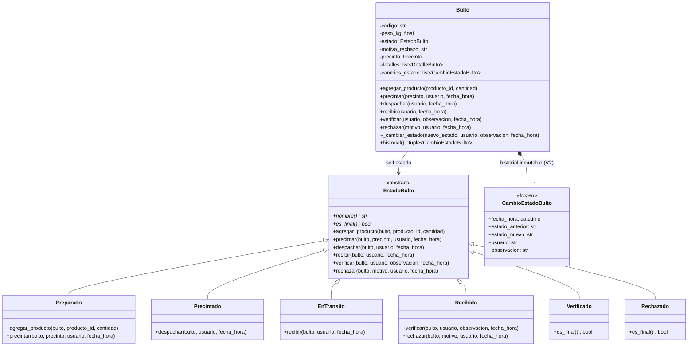
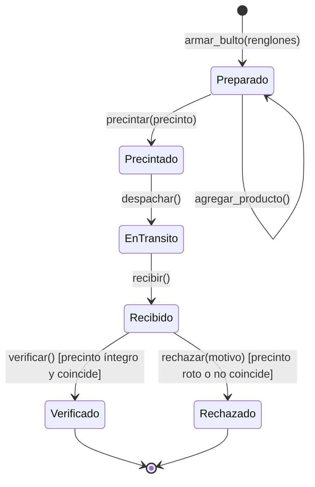
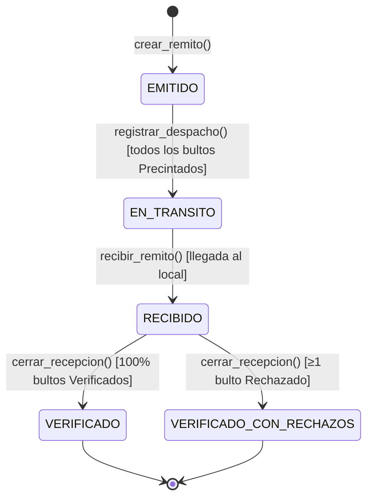

# Módulo de Logística: Bultos, Remitos, Precintos y Trazabilidad – turco

Implementa el paquete **Logística** de `modelo_dominio.md`: los procesos obligatorios **P4**, **P5** y **P6**, las validaciones críticas **V1** y **V2**, el patrón de diseño **State (GoF)** para el ciclo de vida del bulto y el reporte no trivial **R5**. Consume `StockService` y `ReposicionService` (publicados por `pohlsi`) manteniendo el contrato `Referencia("REMITO", remito_id)` que alimenta los reportes **R3** y **R4**.

## Qué hay y dónde

| Capa | Archivo | Contenido |
|------|---------|-----------|
| Dominio y Patrón State | `src/dominio/logistica/modelos.py` | `EstadoBulto(ABC)` y sus 6 estados concretos (`Preparado`, `Precintado`, `EnTransito`, `Recibido`, `Verificado`, `Rechazado`), `Bulto`, `DetalleBulto`, `Precinto`, `CambioEstadoBulto` (`frozen=True`), `Remito`, `EstadoRemito`, `Despacho`, `Recepcion`, `ControlBulto`, `TransicionInvalidaError` |
| Esquema SQL | `src/persistencia/esquema/03_logistica.sql` | Tablas `despacho`, `remito`, `despacho_remito`, `bulto`, `detalle_bulto`, `precinto`, `cambio_estado_bulto`, `recepcion`, `control_bulto`, restricciones `UNIQUE`/`CHECK` y triggers de inmutabilidad (`cambio_estado_bulto_no_update`, `cambio_estado_bulto_no_delete`) |
| Persistencia | `src/persistencia/repositorio_logistica.py` | Repositorios por entidad (`RemitoRepositorio`, `BultoRepositorio`, `DetalleBultoRepositorio`, `PrecintoRepositorio`, `CambioEstadoBultoRepositorio`, `DespachoRepositorio`, `RecepcionRepositorio`, `ControlBultoRepositorio`) |
| Servicios | `src/servicios/logistica_service.py` | `LogisticaService` y `EspecificacionBulto` (procesos transaccionales P4, P5, P6 y validaciones V1 y V2) |
| Reportes | `src/reportes/logistica_reporte.py` | **R5** – `ReporteBultosRechazados`: bultos rechazados, desglose de mermas valorizadas por producto y tasas de rechazo por sucursal |
| Pantallas Tkinter | `src/ui/pantallas/logistica.py` | Pantallas del menú **Logística** (Armado de bultos y remitos, Despacho, Recepción en sucursal, Trazabilidad de bultos, Carga de datos de prueba) y del menú **Reportes** (R5) |
| Datos de prueba | `src/datos_prueba_logistica.py` | `python -m src.datos_prueba_logistica` o menú Logística → *Cargar datos de prueba de logística* |
| Tests | `tests/test_logistica.py`, `tests/test_reporte_logistica.py` | Pruebas exhaustivas con `pytest` y `unittest` |

## Trazabilidad con la consigna

| Requisito | Cómo se cumple |
|-----------|----------------|
| **P4** – Empaquetar mercadería en bultos asignando remito y precinto | `LogisticaService.crear_remito`, `armar_bulto`, `precintar_bulto` y `armar_remito`: a partir de una `OrdenReposicion`, verifican el stock disponible en el CD, empaquetan los productos solicitados, informan el avance con `ReposicionService.registrar_preparado` y asignan el `Precinto` con número único en todo el sistema (`Preparado` → `Precintado`). |
| **P5** – Registrar el despacho de los bultos desde el CD | `LogisticaService.registrar_despacho`: exige que todos los bultos del remito estén `Precintado`, los transiciona a `EnTransito`, descuenta el stock disponible del CD (`EGRESO_DESPACHO`) e ingresa las unidades como **pendientes** en la sucursal destino (`INGRESO_PENDIENTE`) usando `Referencia("REMITO", remito.id)`. |
| **P6** – Registrar la recepción en el local destino verificando el precinto | `LogisticaService.recibir_remito`, `registrar_control_bulto`, `cerrar_recepcion` y `procesar_recepcion_completa`: registran la llegada del remito (`EnTransito` → `Recibido`) y controlan cada bulto comparando el número de precinto leído en el local contra el colocado en el CD y su integridad física. |
| **V1** – No impactar como *Disponible* hasta verificar; precinto roto pasa a *Rechazado* | Mientras el remito viaja (`EN_TRANSITO`) o acaba de llegar (`RECIBIDO`), la mercadería permanece en `cantidad_pendiente` (`stock_disponible == 0`, no se puede vender). Recién al cerrar la recepción: los bultos `Verificado` ejecutan `confirmar_disponible` y `registrar_recibido`; los bultos `Rechazado` ejecutan `registrar_merma` (`MERMA_RECHAZO`), bloqueando su venta. |
| **V2** – Trazabilidad inmutable de estados del bulto | Cada transición agrega un `CambioEstadoBulto` (`@dataclass(frozen=True)`) y hace `INSERT` en `cambio_estado_bulto`. Dos triggers de SQLite (`cambio_estado_bulto_no_update` y `cambio_estado_bulto_no_delete`) abortan cualquier intento de modificación o borrado. |
| **Patrón State (GoF)** | Ver sección siguiente. |
| **R5** – Bultos rechazados y mermas por rotura de precinto | `ReporteBultosRechazados`: filtra por período, sucursal, categoría y tipo de anomalía (`Precinto roto/violado`, `Precinto no coincide`, `Roto y no coincide`), valorizando las mermas al costo y graficando el impacto por sucursal. |

## Patrón State

- **Contexto (`Bulto`):** mantiene en `self.estado` una referencia a una instancia de una subclase de `EstadoBulto` (nunca un string plano) y delega todas las operaciones del ciclo de vida (`self.estado.precintar(self, ...)`, `self.estado.despachar(self, ...)`, etc.).
- **Estado abstracto (`EstadoBulto`):** declara la interfaz común y define por defecto que toda operación no permitida en el estado actual lance `TransicionInvalidaError`.
- **Estados concretos (`Preparado`, `Precintado`, `EnTransito`, `Recibido`, `Verificado`, `Rechazado`):** cada clase encapsula únicamente las reglas y transiciones válidas desde ese estado, eliminando condicionales `if/elif` acoplados y asegurando que los estados terminales (`Verificado` y `Rechazado`) sean inmutables.

## Diagramas de estados

### Ciclo de vida del Bulto (P4, P5, P6, V1, V2)

### Ciclo de vida del Remito

### Impacto de cada etapa logística en los tres baldes de stock

| Etapa / Estado del Bulto | Stock Disponible CD | Stock Pendiente Local | Stock Disponible Local | Stock Merma Local | Movimiento en `StockService` |
|--------------------------|:-------------------:|:---------------------:|:----------------------:|:-----------------:|------------------------------|
| `Preparado` / `Precintado` (P4) | Sin cambio (reservado) | `0` | `0` | `0` | — (`registrar_preparado` en la orden) |
| `EnTransito` (P5 – Despacho) | **−** | **+** | `0` (no vendible) | `0` | `EGRESO_DESPACHO` (CD) + `INGRESO_PENDIENTE` (Local) |
| `Recibido` (P6 – Llegada) | — | Se mantiene | `0` (no vendible) | `0` | — (aguarda control de precinto – **V1**) |
| `Verificado` (Cierre recepción) | — | **−** | **+** (habilita venta) | `0` | `CONFIRMACION_VERIFICADO` + `registrar_recibido` |
| `Rechazado` (Cierre recepción) | — | **−** | `0` (bloquea venta) | **+** | `MERMA_RECHAZO` |

## Reporte R5 y Datos de prueba

- **R5 – Bultos rechazados y mermas por rotura de precinto (`ReporteBultosRechazados`):** consulta para un rango `[desde, hasta]` (filtrable por sucursal, categoría y tipo de anomalía) todos los bultos rechazados en recepciones cerradas, comparando el precinto colocado en el CD contra el leído en el local, valorizando la pérdida al costo unitario del movimiento `MERMA_RECHAZO` y calculando el porcentaje de rechazo sobre el total de bultos evaluados por cada sucursal.
- **Datos de prueba (`src/datos_prueba_logistica.py`):** luego de ejecutar `python -m src.datos_prueba` y `python -m src.datos_prueba_inventario`, correr `python -m src.datos_prueba_logistica` (o desde el menú **Logística → Cargar datos de prueba de logística**) genera tres órdenes completas:
  1. `REM-0001` hacia **Sucursal Centro**: despachado, recibido y **100% verificado** (`BUL-0001` y `BUL-0002`).
  2. `REM-0002` hacia **Sucursal Nueva Córdoba**: con un bulto verificado (`BUL-0003`), un bulto rechazado por **precinto roto/violado** (`BUL-0004`) y otro rechazado por **número de precinto adulterado** (`BUL-0005`), dejando listos el **Reporte R5** y la pantalla de **Trazabilidad**.
  3. `REM-0003` hacia **Sucursal Cerro de las Rosas**: actualmente **`EN_TRANSITO`** (`BUL-0006` y `BUL-0007`), más una cuarta orden `PENDIENTE`, listas para demostrar en vivo el armado, el despacho y la recepción durante la defensa del TPI.
