# Modelo de dominio – Diagrama de clases

Diagramas de clases del sistema **tal como quedó implementado**. Los nombres de clases, atributos y
métodos son los mismos que en el código (`src/dominio/` y `src/servicios/`). Están escritos en
[Mermaid](https://mermaid.js.org/), así que GitHub los dibuja directamente.

El sistema se organiza en cuatro paquetes y una capa de persistencia común:

| Paquete | Carpeta | Clases principales | Procesos y validaciones de la consigna |
|---------|---------|--------------------|-----------------------------------------|
| Maestros | `dominio/maestros` | `Ubicacion`, `Sucursal`, `CentroDistribucion`, `Categoria`, `Producto`, `HistorialPrecio`, `Proveedor`, `ProductoProveedor`, `StockMinimo` | P1, P2, V4 |
| Inventario, compras y reposición | `dominio/inventario` | `Stock`, `MovimientoStock`, `OrdenCompra`, `NecesidadReposicion`, `OrdenReposicion` | P3, base de V1 y V3, compras sugeridas (opcional) |
| Logística | `dominio/logistica` | `Remito`, `Bulto`, `EstadoBulto` y sus estados, `Precinto`, `CambioEstadoBulto`, `Despacho`, `Recepcion`, `ControlBulto` | P4, P5, P6, V1, V2 |
| Ventas | `dominio/ventas` | `Venta`, `DetalleVenta`, `Cobro`, `MedioPago` y sus medios, `Comprobante` y sus tipos, `Devolucion`, `Caja`, `Cliente` | P7, V3, V5 |
| Persistencia | `persistencia` | `BaseDeDatos`, `RepositorioBase` | — |

**Convenciones de los diagramas**

- Las entidades son `@dataclass`; sus atributos son públicos (`+`). `id` vale `None` hasta que se guarda.
- Entre paquetes las entidades se relacionan **por id** (por ejemplo `Producto.categoria_id`): la
  relación se dibuja con el nombre del atributo que la implementa.
- La lógica que necesita la base de datos o coordina varias entidades está en las clases `...Service`
  de `src/servicios/`, que también se muestran.

---

## 1. Vista general

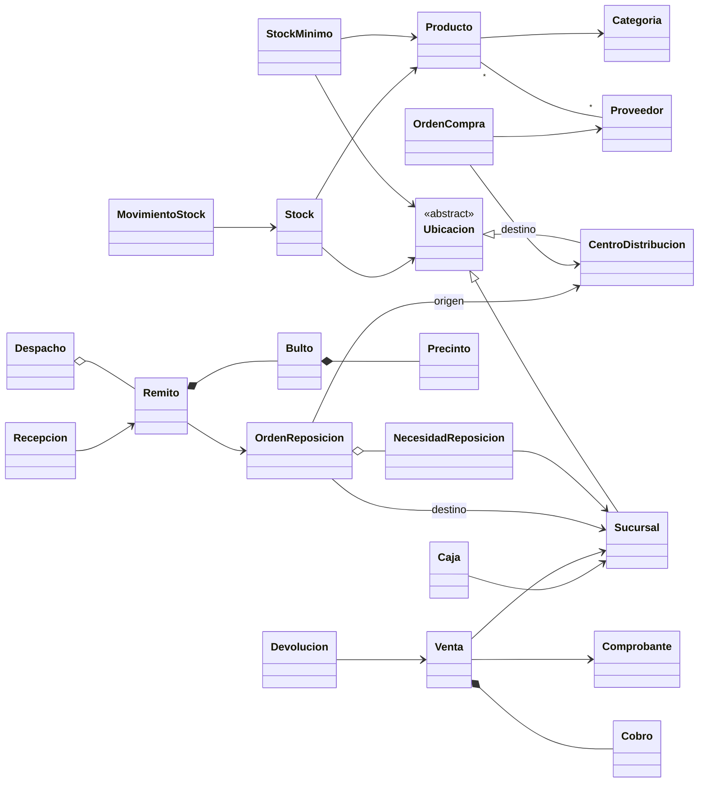

**Flujo de punta a punta:**
`OrdenCompra` (proveedor → CD) → `NecesidadReposicion` (cada local) → `OrdenReposicion` (CD → local)
→ `Bulto` + `Precinto` + `Remito` → `Despacho` → `Recepcion` → stock *disponible* → `Venta` → `Devolucion`.

Todos los cambios de stock de ese flujo pasan por **`StockService`** y quedan registrados como
`MovimientoStock`, con una `Referencia` al documento que los originó (orden de compra, remito, venta o
devolución).

---

## 2. Maestros

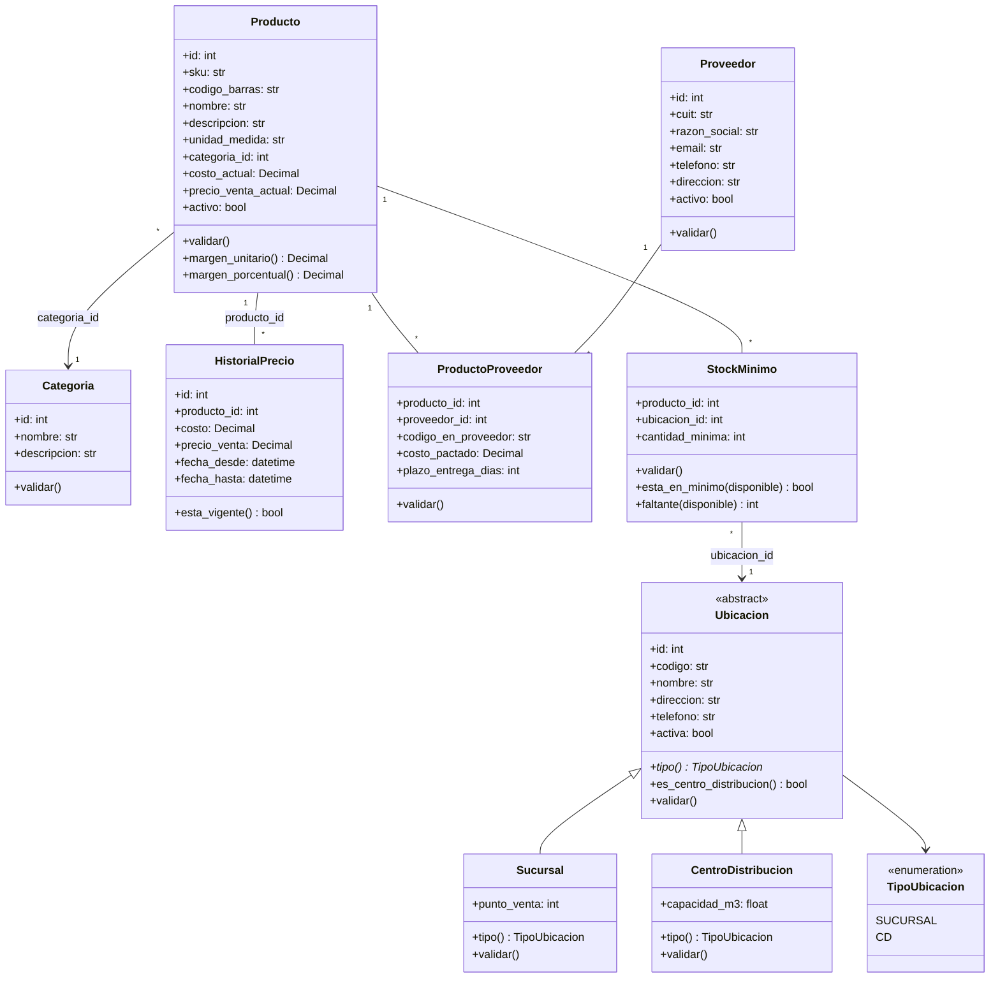

```mermaid
classDiagram
    class UbicacionService {
        +listar(incluir_inactivas) list~Ubicacion~
        +listar_sucursales(incluir_inactivas) list~Sucursal~
        +obtener(ubicacion_id) Ubicacion
        +guardar(ubicacion) Ubicacion
        +dar_de_baja(ubicacion_id)
        +reactivar(ubicacion_id) Ubicacion
    }
    class CategoriaService {
        +listar() list~Categoria~
        +guardar(categoria) Categoria
        +eliminar(categoria_id)
    }
    class ProductoService {
        +listar(incluir_inactivos) list~Producto~
        +buscar(texto, incluir_inactivos) list~Producto~
        +obtener(producto_id) Producto
        +guardar(producto) Producto
        +dar_de_baja(producto_id)
        +reactivar(producto_id) Producto
        +historial_precios(producto_id) list~HistorialPrecio~
        +precio_vigente_en(producto_id, momento) HistorialPrecio
        +proveedores_de(producto_id) list~ProductoProveedor~
        +asignar_proveedor(relacion) ProductoProveedor
        +quitar_proveedor(producto_id, proveedor_id)
    }
    class ProveedorService {
        +listar(incluir_inactivos) list~Proveedor~
        +obtener(proveedor_id) Proveedor
        +guardar(proveedor) Proveedor
        +dar_de_baja(proveedor_id)
        +reactivar(proveedor_id) Proveedor
        +productos_de(proveedor_id) list~ProductoProveedor~
    }
    class StockMinimoService {
        +definir(minimo) StockMinimo
        +quitar(producto_id, ubicacion_id)
        +de_producto(producto_id) list~StockMinimo~
        +de_ubicacion(ubicacion_id) dict
        +minimo(producto_id, ubicacion_id) int
        +esta_en_minimo(producto_id, ubicacion_id, disponible) bool
    }
```

- **Herencia:** `Sucursal` y `CentroDistribucion` heredan de la clase abstracta `Ubicacion`, que obliga a
  definir `tipo()`. En la base van en **una sola tabla `ubicacion` con un campo `tipo`**, así el stock se
  maneja igual en el CD y en los locales. Solo puede haber un CD activo.
- **V4 (no duplicados):** `Producto.sku`, `Producto.codigo_barras` y `Proveedor.cuit` son únicos. Se valida
  en el servicio (con un mensaje claro) y además con `UNIQUE` en la base. El CUIT se valida con su dígito
  verificador.
- **Precios:** al cambiar el costo o el precio, `ProductoService` cierra el `HistorialPrecio` vigente y abre
  uno nuevo, así se sabe qué precio tenía un producto en cualquier fecha.
- **`StockMinimo`** es el nivel mínimo de cada producto **en cada ubicación** (P2). Un producto está *en stock
  mínimo* cuando su disponible llega al mínimo o queda por debajo; inventario lo consulta para el Observer.
- Las bajas son **lógicas** (`activo` / `activa`): un producto dado de baja sigue ocupando su SKU.

---

## 3. Inventario, compras y reposición

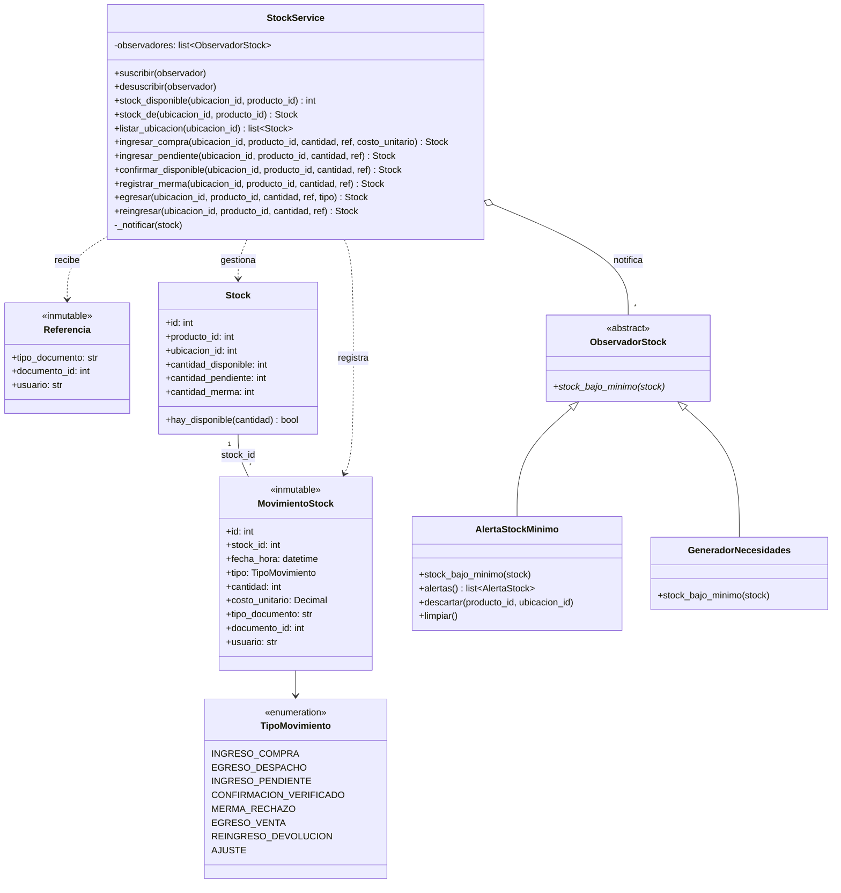

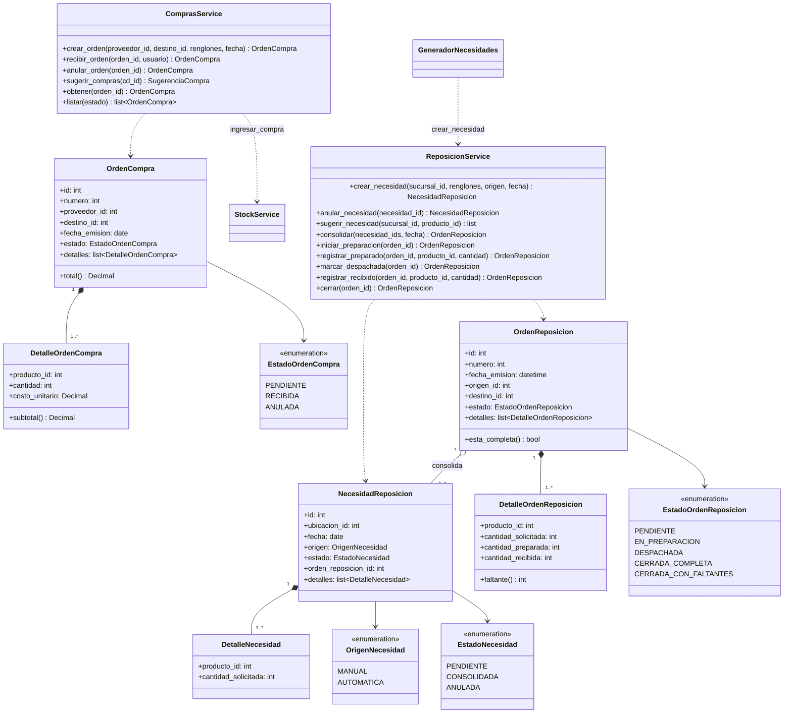

Relaciones con otros paquetes: `Stock → Producto, Ubicacion`; `OrdenCompra → Proveedor, CentroDistribucion (destino)`;
`DetalleX → Producto`; `NecesidadReposicion → Sucursal`;
`OrdenReposicion → CentroDistribucion (origen), Sucursal (destino)`.

- **Stock con tres "baldes":** *pendiente* (llegó al local pero no se verificó), *disponible* (verificado, se
  puede vender) y *merma* (rechazado). Así se cumple **V1** de forma explícita: solo el disponible se vende.
- **V3:** `StockService.egresar` lanza `StockInsuficienteError` si no alcanza el disponible; además la base
  tiene `CHECK (cantidad_disponible >= 0)`.
- **Trazabilidad:** todo cambio de stock pasa por `StockService` y deja un `MovimientoStock`. Los movimientos
  no se pueden modificar ni borrar (triggers en la base) y alimentan los reportes de movimientos,
  valorización y tiempo de tránsito.
- **Patrón Observer:** `StockService` es el *sujeto*. Después de cada egreso consulta `StockMinimoService` y,
  si el producto quedó en su mínimo, notifica a todos los `ObservadorStock` suscriptos.
  `AlertaStockMinimo` muestra la alerta en pantalla y `GeneradorNecesidades` crea una
  `NecesidadReposicion` **automática** para el local (sin duplicar una que ya esté abierta).
- **P3 (consolidación):** `ReposicionService.consolidar` junta las necesidades pendientes de **un** local en
  **una** `OrdenReposicion` con origen (CD) y destino (local), sumando cantidades por producto.
- **Compras (opcional de la consigna):** `ComprasService.sugerir_compras` calcula, para cada producto del CD
  en su mínimo, *mínimo − disponible − lo ya pedido*, agrupado por el proveedor con menor costo pactado.

### Ciclo de vida de la orden de reposición

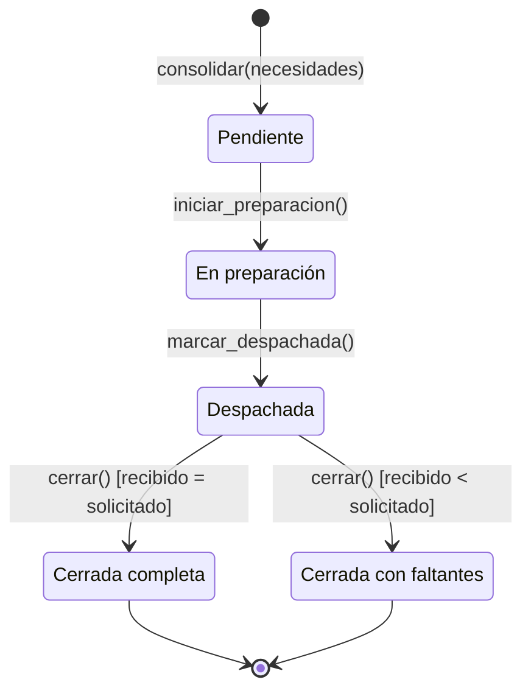

Las transiciones válidas están en la tabla `TRANSICIONES` de `reposicion_service.py`; cualquier otra lanza
`ValidacionError`. El avance lo informa logística al armar los bultos, despachar y recibir.

---

## 4. Logística

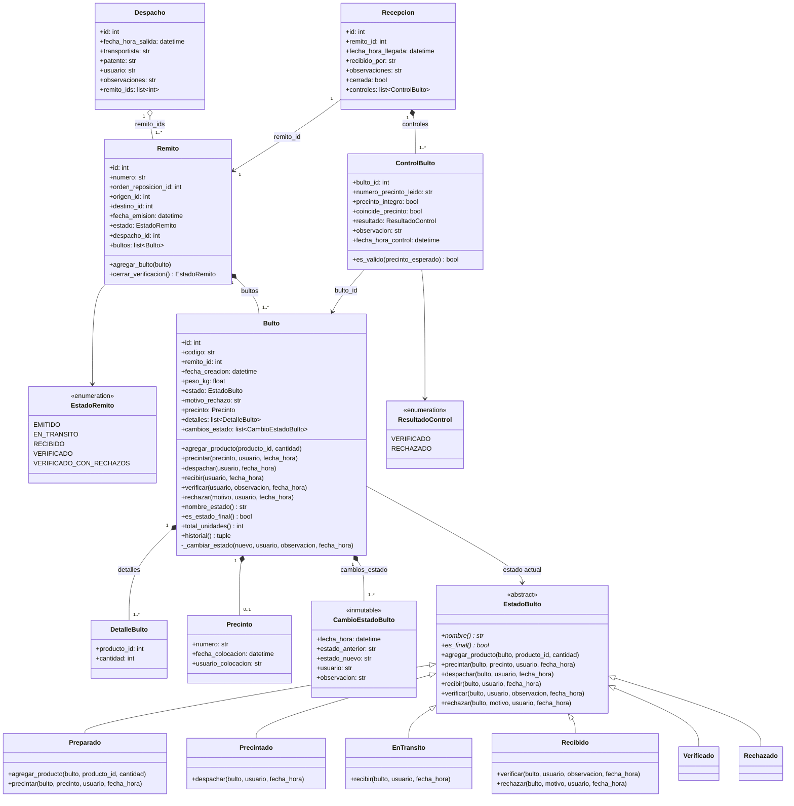

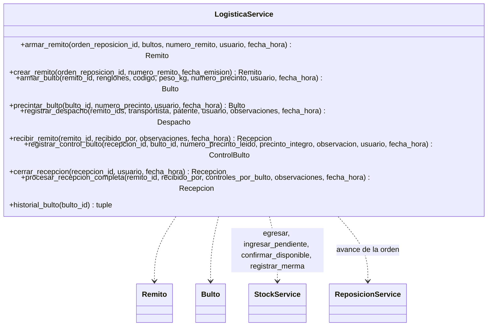

Relaciones con otros paquetes: `Remito → OrdenReposicion` (y de ahí origen y destino); `DetalleBulto → Producto`.

- **Patrón State:** `Bulto` delega cada acción en su `EstadoBulto` actual. La clase abstracta implementa todas
  las acciones lanzando `TransicionInvalidaError`; cada estado concreto redefine **solo** las que son válidas
  para él (por ejemplo, `Precintado` solo sabe `despachar`). `Verificado` y `Rechazado` son finales.
- **V2 (trazabilidad inmutable):** cada transición agrega un `CambioEstadoBulto` (`@dataclass(frozen=True)`).
  En la base, la tabla `cambio_estado_bulto` tiene triggers que impiden `UPDATE` y `DELETE`.
- **P4:** a partir de una orden de reposición se arman los bultos, cada uno con su precinto de número único,
  y se agrupan en un remito.
- **P5:** al despachar, el stock egresa del CD (`egresar` con `EGRESO_DESPACHO`) e ingresa como **pendiente** en
  el local (`ingresar_pendiente`). Todos los movimientos llevan la referencia `REMITO`.
- **P6 y V1:** en la recepción se registra un `ControlBulto` por bulto. Si el precinto leído coincide con el
  colocado y está íntegro, el bulto pasa a *Verificado*; si no, a *Rechazado* (rechazo logístico). Al cerrar la
  recepción el remito queda `VERIFICADO` o `VERIFICADO_CON_RECHAZOS`, y **recién ahí** se llama a
  `confirmar_disponible` por lo verificado y a `registrar_merma` por lo rechazado.

### Ciclo de vida del bulto

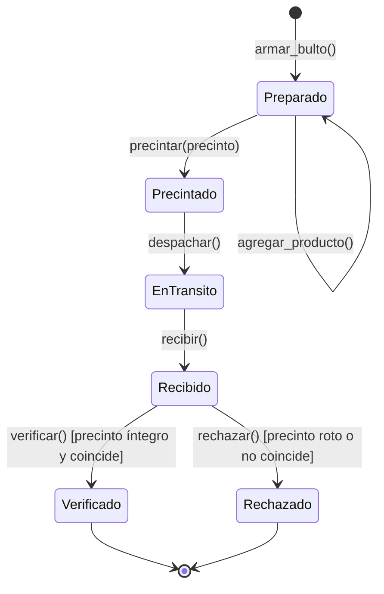

| Estado | Efecto en stock |
|--------|-----------------|
| Preparado / Precintado | Sigue en el CD (disponible del CD) |
| En tránsito | Egresa del CD e ingresa como **pendiente** en el local |
| Recibido | Sigue **pendiente**: no se puede vender |
| Verificado | Pasa de pendiente a **disponible** |
| Rechazado | Pasa de pendiente a **merma** (rechazo logístico) |

---

## 5. Ventas, cobros y devoluciones

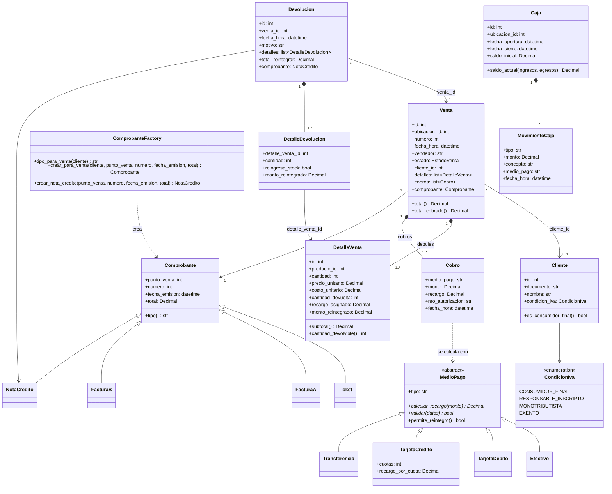

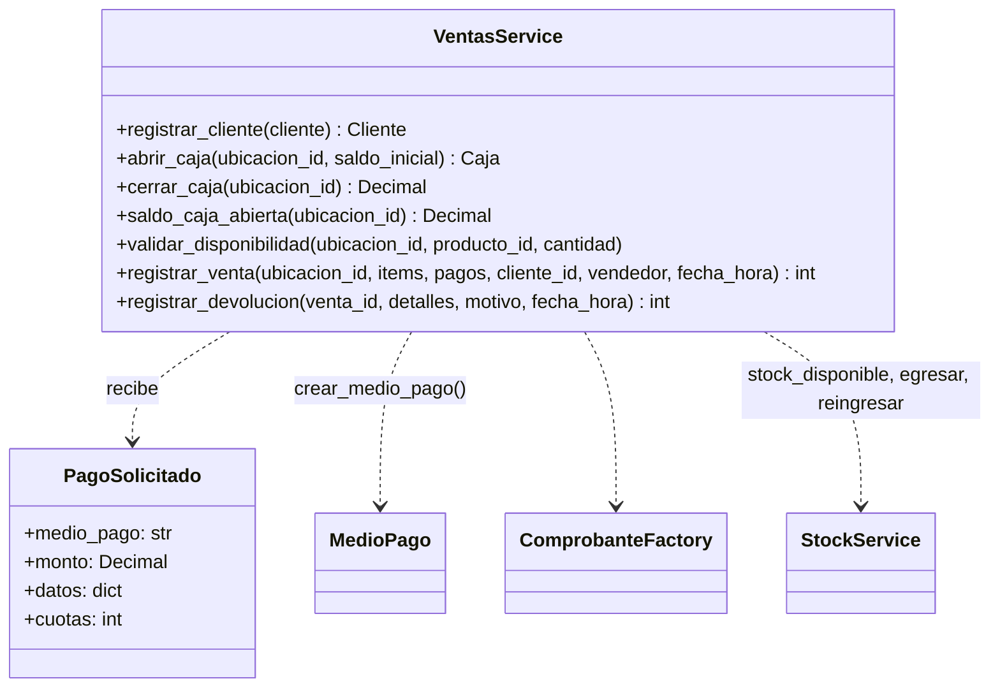

Relaciones con otros paquetes: `Venta → Sucursal`; `DetalleVenta → Producto`; `Caja → Sucursal`.

- **P7:** una venta tiene uno o más renglones, uno o más cobros (pago mixto) y un comprobante con numeración
  correlativa por local. Cada cobro y cada reintegro queda como `MovimientoCaja` de la caja abierta del local.
- **V3:** antes de confirmar se consulta `StockService.stock_disponible` (solo stock **verificado**) y al
  confirmar se llama a `egresar`. Todo ocurre en una transacción: si algo falla, no queda ni la venta, ni los
  cobros, ni el movimiento de stock.
- `DetalleVenta` guarda **el precio y el costo del momento de la venta**, así el reporte de margen no cambia
  si después se actualiza el producto.
- **Patrón Strategy:** cada `MedioPago` calcula su recargo y valida sus datos a su manera (por ejemplo,
  `TarjetaCredito` suma un recargo por cuota); la venta no pregunta "¿es tarjeta?". `crear_medio_pago()` elige
  la estrategia según el medio indicado.
- **Patrón Factory:** `ComprobanteFactory` decide Ticket, Factura A o Factura B según la condición frente al IVA
  del cliente, y crea la Nota de crédito de las devoluciones.
- **V5 (devoluciones):** una `Devolucion` siempre apunta a una `Venta` registrada; por cada renglón,
  `cantidad ≤ DetalleVenta.cantidad_devolvible()`, el renglón debe pertenecer a esa venta y la devolución debe
  estar dentro del plazo (30 días). Si `reingresa_stock` es verdadero se llama a `StockService.reingresar`.
  Genera una `NotaCredito` y un egreso en la `Caja`.

---

## 6. Persistencia

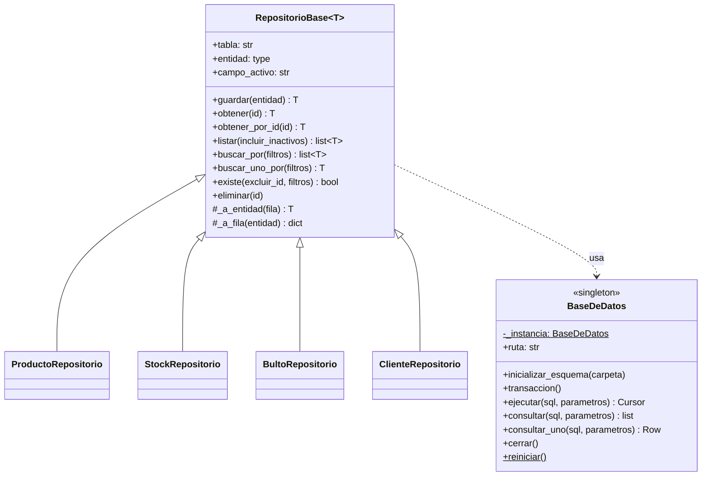

- **Patrón Singleton:** `BaseDeDatos` redefine `__new__` para que toda la aplicación comparta **una única**
  conexión a SQLite. `transaccion()` permite anidar operaciones: confirma al salir de la más externa y, si
  algo falla adentro, deshace todo.
- **Patrón Repository:** `RepositorioBase[T]` resuelve el guardado y la lectura de cualquier entidad a partir
  de su tabla y su clase. Cada paquete tiene sus repositorios (en `repositorio_maestros.py`,
  `repositorio_inventario.py`, `repositorio_logistica.py` y `repositorio_ventas.py`); en el diagrama se muestra
  uno de cada paquete como ejemplo. Cuando un atributo no coincide con una columna (por ejemplo, un enum o una
  lista de detalles), el repositorio redefine `_a_entidad` y `_a_fila`.

---

## 7. Patrones de diseño aplicados

| Patrón | Dónde | Para qué |
|--------|-------|----------|
| **Singleton** | `BaseDeDatos` (`persistencia/conexion.py`) | Una sola conexión compartida y transacciones anidadas |
| **Repository** | `RepositorioBase` y sus subclases (`persistencia/`) | Separar el dominio del SQL |
| **Observer** | `StockService` → `ObservadorStock` (`servicios/stock_service.py`, `observadores_stock.py`, `generador_necesidades.py`) | Avisar y generar necesidades cuando un producto llega a su stock mínimo |
| **State** | `Bulto` → `EstadoBulto` (`dominio/logistica/modelos.py`) | Ciclo de vida del bulto con transiciones válidas |
| **Strategy** | `MedioPago` y sus medios (`dominio/ventas/modelos.py`) | Recargo y validación propios de cada medio de pago |
| **Factory** | `ComprobanteFactory` (`dominio/ventas/modelos.py`) | Elegir y crear el tipo de comprobante |
