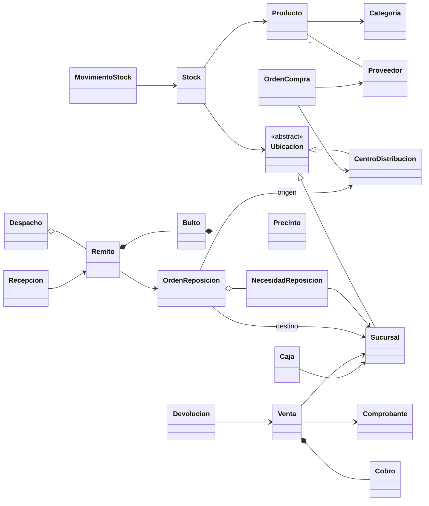
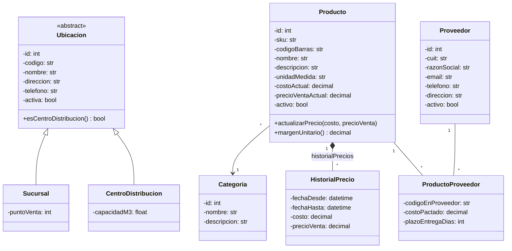
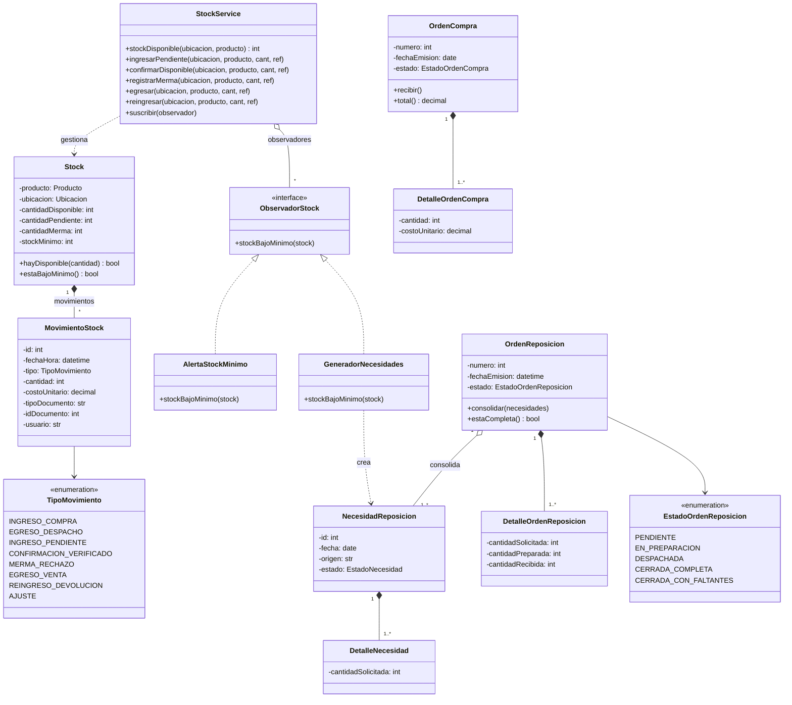
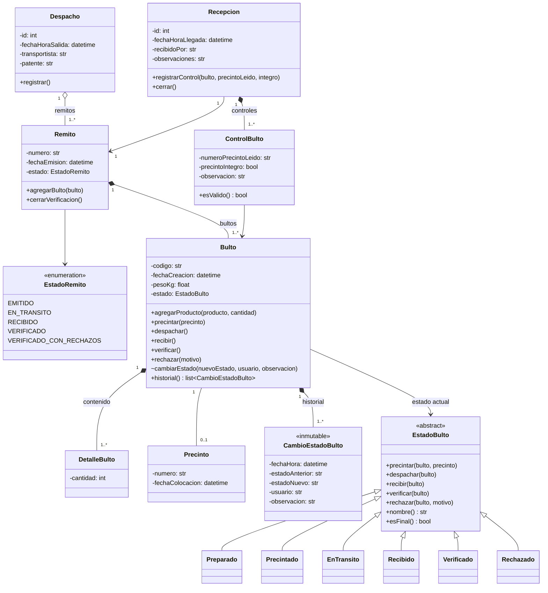
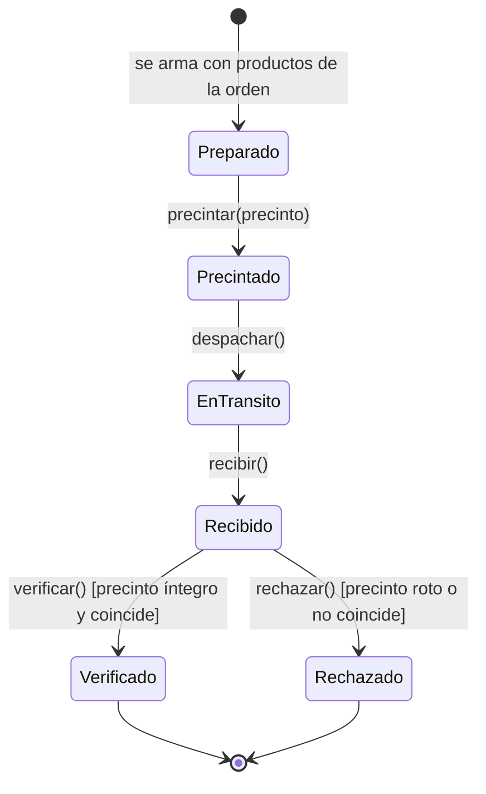
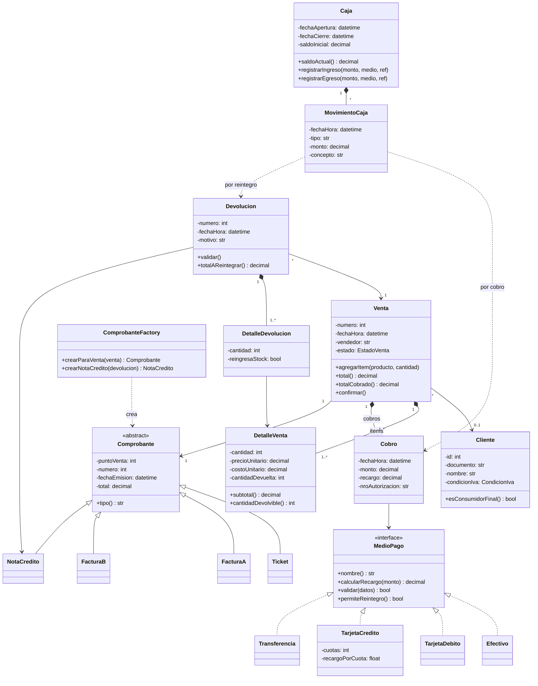

# Modelo de dominio – Diagrama de clases

Primera versión del modelo de dominio para discutir en grupo. Los diagramas están en
[Mermaid](https://mermaid.js.org/), así que GitHub los dibuja solos y se pueden editar como texto.

El modelo se divide en 4 paquetes, uno por integrante:

| Paquete | Responsable | Clases principales |
|---------|-------------|--------------------|
| Maestros | brache | `Ubicacion`, `Sucursal`, `CentroDistribucion`, `Categoria`, `Producto`, `HistorialPrecio`, `Proveedor`, `ProductoProveedor` |
| Inventario y reposición | pohlsi | `Stock`, `MovimientoStock`, `OrdenCompra`, `NecesidadReposicion`, `OrdenReposicion` |
| Logística | turco | `Remito`, `Bulto`, `Precinto`, `EstadoBulto` (State), `CambioEstadoBulto`, `Despacho`, `Recepcion`, `ControlBulto` |
| Ventas | vinchi | `Venta`, `DetalleVenta`, `Cobro`, `MedioPago` (Strategy), `Comprobante`, `Devolucion`, `Caja`, `MovimientoCaja`, `Cliente` |

---

## 1. Vista general

Solo las clases y cómo se conectan los paquetes (los atributos están en las secciones siguientes).

**Flujo de punta a punta:**
`OrdenCompra` (proveedor → CD) → `NecesidadReposicion` (cada local) → `OrdenReposicion` (CD → local)
→ `Bulto` + `Precinto` + `Remito` → `Despacho` → `Recepcion` → stock *Disponible* → `Venta` → `Devolucion`.

---

## 2. Maestros (brache)

- **V4 (no duplicados):** `Producto.sku`, `Producto.codigoBarras` y `Proveedor.cuit` son únicos.
- `Sucursal` y `CentroDistribucion` heredan de `Ubicacion`. En la base de datos van en **una sola
  tabla `ubicacion` con un campo `tipo`**, así el stock se maneja igual en el CD y en los locales.
- `HistorialPrecio` cubre "administrar precios" y permite saber qué precio y costo tenía un producto en una fecha dada.
- El **stock mínimo** no está en `Producto` porque depende de cada local: está en `Stock` (paquete de inventario).

---

## 3. Inventario, compras y reposición (pohlsi)

Relaciones con otros paquetes (no dibujadas para no ensuciar): `Stock → Producto, Ubicacion`;
`OrdenCompra → Proveedor, CentroDistribucion`; `DetalleX → Producto`;
`NecesidadReposicion → Sucursal`; `OrdenReposicion → CentroDistribucion (origen), Sucursal (destino)`.

- **Stock con tres "baldes":** *pendiente* (llegó o está en camino pero no se verificó), *disponible*
  (verificado, se puede vender) y *merma* (rechazado). Así se cumple **V1** de forma explícita.
- **Todo cambio de stock pasa por `StockService`** y deja un `MovimientoStock`. Los movimientos nunca
  se editan: alimentan los reportes de movimientos y valorización.
- **Patrón Observer:** `StockService` notifica a los `ObservadorStock` cuando un producto queda bajo el
  mínimo. `GeneradorNecesidades` crea automáticamente una `NecesidadReposicion` (el campo `origen`
  dice si fue manual o automática).
- **Consolidación (P3):** varias `NecesidadReposicion` de un mismo local se juntan en **una**
  `OrdenReposicion` con origen (CD) y destino (local), sumando cantidades por producto.

---

## 4. Logística (turco)

Relaciones con otros paquetes: `Remito → OrdenReposicion` (y de ahí origen/destino); `DetalleBulto → Producto`.

- **Patrón State:** `Bulto` delega cada acción en su `EstadoBulto` actual. Cada estado concreto
  implementa solo las transiciones válidas y en las demás lanza `TransicionInvalidaError`
  (por ejemplo, no se puede despachar un bulto sin precintar).
- **V2 (trazabilidad inmutable):** cada transición agrega un `CambioEstadoBulto` y nunca se modifica ni se borra
  (en Python, `@dataclass(frozen=True)`; en la base, solo `INSERT`).
- **Recepción (P6):** por cada bulto se registra un `ControlBulto`. Si el precinto leído coincide con el
  colocado y está íntegro, el bulto pasa a *Verificado*; si no, a *Rechazado*.
- **V1:** al cerrar la `Recepcion`, el remito pasa a `VERIFICADO` o `VERIFICADO_CON_RECHAZOS`. **Recién ahí**
  se llama a `StockService.confirmarDisponible` por los bultos verificados y a `registrarMerma` por los rechazados.

### Ciclo de vida del bulto

| Estado | Efecto en stock |
|--------|-----------------|
| Preparado / Precintado | Sigue en el CD (disponible del CD) |
| En tránsito | Egresa del CD (`egresar`) e ingresa como **pendiente** en el local (`ingresarPendiente`) |
| Recibido | Sigue **pendiente**: no se puede vender |
| Verificado | Pasa de pendiente a **disponible** (`confirmarDisponible`) |
| Rechazado | Pasa de pendiente a **merma** (`registrarMerma`): rechazo logístico |

---

## 5. Ventas, cobros y devoluciones (vinchi)

Relaciones con otros paquetes: `Venta → Sucursal`; `DetalleVenta → Producto`; `Caja → Sucursal`.

- **V3:** al agregar un ítem y al confirmar la venta se consulta `StockService.stockDisponible` (solo
  stock **verificado**). Al confirmar, se llama a `egresar`.
- `DetalleVenta.costoUnitario` **guarda el costo al momento de la venta**, así el reporte de margen
  no cambia si después se actualiza el costo del producto.
- **Patrón Strategy:** cada `MedioPago` calcula su recargo y valida sus datos a su manera; la venta no
  pregunta "¿es tarjeta?". Una venta puede tener varios `Cobro` (pago mixto).
- **Patrón Factory:** `ComprobanteFactory` decide Ticket / Factura A / Factura B según el cliente.
- **V5 (devoluciones):** una `Devolucion` siempre apunta a una `Venta` existente; por cada ítem,
  `cantidad ≤ DetalleVenta.cantidadDevolvible()` y debe estar dentro del plazo (por ejemplo, 30 días).
  Si `reingresaStock` es verdadero, se llama a `StockService.reingresar`. Genera una `NotaCredito` y un egreso en `Caja`.

---

## 6. Dónde se cumple cada validación de la consigna

| Validación | Dónde se resuelve en el modelo |
|-----------|-------------------------------|
| V1 – Stock disponible solo tras verificar | `Stock.cantidadPendiente` vs. `cantidadDisponible`; `Recepcion.cerrar()` → `confirmarDisponible` / `registrarMerma` |
| V2 – Trazabilidad inmutable del bulto | `CambioEstadoBulto` (inmutable, solo se agrega) + patrón State |
| V3 – No vender más que el stock verificado | `Venta.agregarItem/confirmar` → `StockService.stockDisponible` |
| V4 – Sin productos ni proveedores duplicados | `Producto.sku`, `Producto.codigoBarras`, `Proveedor.cuit` únicos |
| V5 – Devoluciones válidas | `Devolucion → Venta` obligatoria + `DetalleVenta.cantidadDevolvible()` + plazo |

## 7. Patrones de diseño

| Patrón | Dónde | Responsable |
|--------|-------|-------------|
| **State** | `Bulto` / `EstadoBulto` y sus 6 estados | turco |
| **Strategy** | `MedioPago` y sus implementaciones | vinchi |
| **Observer** | `StockService` / `ObservadorStock` | pohlsi |
| **Factory Method** | `ComprobanteFactory` | vinchi |
| **Singleton** + **Repository** | Conexión a la BD y repositorios (capa de persistencia, no se ve en el dominio) | brache |

---

## 8. Decisiones abiertas para charlar en grupo

1. **¿Una orden de reposición por local o una para varios locales?** El modelo propone una por destino
   (la consigna dice "indicando origen y destino"). Si es para varios, el destino pasa a `DetalleOrdenReposicion`.
2. **Remito con bultos verificados y rechazados mezclados:** se propone que lo verificado se habilite y lo rechazado
   vaya a merma (`VERIFICADO_CON_RECHAZOS`). La alternativa estricta es rechazar el remito entero.
3. **Bulto rechazado:** ¿la mercadería se pierde (merma) o vuelve al CD? Se propone merma, porque el reporte pide "mermas por rotura de precinto".
4. **Plazo y condiciones de devolución:** definir el número de días y si un producto dañado reingresa al stock.
5. **Usuarios:** por ahora `usuario` es un texto. Si la cátedra pide login, se agrega una clase `Usuario` con rol.
6. **Opcionales:** `Cliente` ya está, así que "clientes frecuentes" sería fácil de sumar. Las órdenes de compra
   sugeridas salen casi gratis del Observer.
